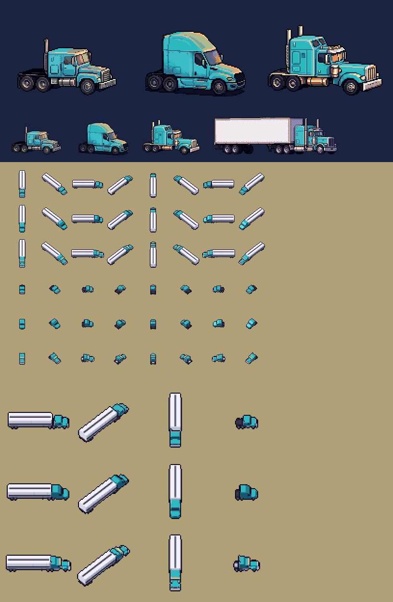

# The three tractor makes: the looks (art, 2026-11-03; sprint 2, item 6)

This is one look per tier the economy already runs, so the Dealer and the map can tell the makes apart in sprint 3.
All three are semis, with the tractor drawn apart from any trailer. They have no badges and no lettering, because the
names wait on counsel's trademark search; the shapes alone carry the difference.

Top: the Dealer cards at 2×. Then the same cards at 1× beside today's van card, for scale and colour. Then the map
sheets: van and bobtail, all eight headings, at 1×. Last, the east, north-east and south views at 2×.

## What each silhouette says

- **Keystone (workhorse):** square, short and plain. A mid-length flat hood and a grey steel bumper. A grey grille of
  horizontal bars. A flat-top sleeper no taller than the cab. One grey stack, aluminium tanks and steel wheels. It is
  the cheapest way in, and it looks it: honest, not shabby.
  - **On the map:** the shortest, lowest tractor, with a clear step down from the trailer's roof to its own.
- **Meridian (highway, the fuel saver):** smooth and tall. A short nose that slopes down to a wraparound bumper. A wide
  black grille and a raked windshield. A roof that rises to the trailer's height. Skirts hide the tanks and steps,
  and extenders close the gap to the trailer. No stacks, and almost no chrome. Everything about it says air and
  miles.
  - **On the map:** one block of the owner's colour, flush with the trailer's roof. It is the easiest of the three to
    tell at any zoom.
- **Ironwood (flagship, the driver's favourite):** long and bright. The longest hood, square, behind an upright chrome
  grille of vertical bars. Swept fenders and round chrome air cleaners at the cowl. An upright split windshield under
  a chrome visor with amber lamps. A stand-up sleeper and two tall chrome stacks, plus chrome tanks, bumper, deck
  plate and wheels. It is the truck a driver asks for by name.
  - **On the map:** the longest nose. Its row of amber cab lamps is drawn as one amber bar across the brow, larger than
    life as the map draws the whole rig. Neither of the other two carries one.

At the map's opening zoom a whole rig is 3–4 px, so no make can show there. The makes start to read from about half
size, when the tractor is about 10 px.

## Files

- **Dealer cards:**
  - `apps/web/assets/makes/{keystone,meridian,ironwood}.png`: 128 × 96, transparent.
  - Facing right in the rig cards' three-quarter view, at their density (about 4.3 px a foot).
  - All three are at one scale and on one ground line, so the length and height differences are true. The Ironwood is
    the longest and tallest.
  - The colours are the rig cards' own, the cab in their cyan, so the cards' CSS recolour (red, lime, grey) works the
    same way.
- **Map sheets:**
  - `apps/web/assets/trucks/makes/{make}-{van,reefer,flatbed,bobtail}.png` with `layout.json`.
  - Same layout as `van64` and its siblings: 68-px cells and eight headings in the same order, so `truckSheet` and
    `truckFrame` read them unchanged.
  - The cab's cyan is still the only colour in the 165–210 hue band, so the owner recolour works.
  - The existing `van64`, `reefer64` and `flatbed64` sheets are untouched. Engineering chooses between the two sets in
    sprint 3.
- **Bobtail:** a tractor with no trailer, in case the Dealer or the map ever shows one alone.

## How they're made

- **Models:** `apps/web/tools/makes.py` models each tractor in feet. The card and the map draw the same truck.
- **Card painting:** the card's layout is rendered from the model, then PixelLab repaints it as painterly pixel art.
  It's a Pro edit, which keeps the layout, given a written description of the make. That follows the style guide's
  line 6: cards are painterly, sprites only on the map.
- **Fit:** last, the paint is fitted to the rig cards' cyan, and every other colour snaps to the colours the cards
  use.
- **What failed:** an image-reference repaint either copied the reference or put stacks and bare tanks on the
  Meridian, so the cards were repainted from words instead.
- **Cost:** about 120 generations, tests included.
- **Recipe:** `makes` in `asset-pass.sh`.
- **Map sheets:** rendered by `rig-sheets.py`'s renderer, which gained sloped faces for the new shapes. Its own three
  sheets come out byte for byte the same.

## For sprint 3

- The repaint gives the tops of all three a warm late-light glow, strongest on the Meridian's big roof. It's the house
  light, but if the Dealer shows the cards on a light background it may read as two-tone paint. Worth a look in place.
- The rig cards (tractor plus trailer) are still the old single make. Once the Dealer sells tractors and trailers
  apart, the "rig as a shortcut" may want a rig card per make. The models render that combination already; the
  painting is the cost, about 10 generations a card.
