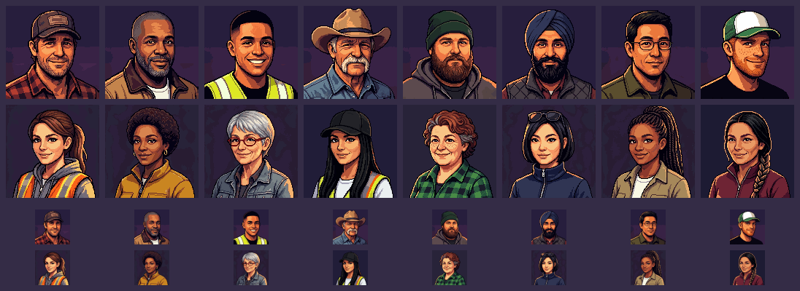

# Driver portraits: sixteen faces (art, 2026-11-03)

Jeff, from the Staff screen on his phone: "We need to make new portraits, there's only 2 for drivers." There are
sixteen now, eight men and eight women. The two originals stay as m1 and f1.

Top two rows: full size (128 px). Bottom two rows: the same faces at the roster's 48 px, scaled smoothly as the
client draws them. Each face should read as a different person by the hat or hair, the colour at the collar, and
the skin and age, even in the 48 px rows.

| File | Who |
|---|---|
| driver-m1 | (the original) forties, worn brown cap, red flannel, stubble |
| driver-m2 | Black, fifties, shaved head, short grey beard, tan canvas work jacket |
| driver-m3 | Latino, twenties, black fade, lime hi-vis vest over a black tee |
| driver-m4 | white, sixties, tan cowboy hat, white walrus moustache, denim snap shirt |
| driver-m5 | heavy-set, thirties, long brown beard, green beanie, grey hoodie |
| driver-m6 | Sikh, forties, navy turban, full black beard, charcoal quilted vest |
| driver-m7 | East Asian, late thirties, wire-rimmed glasses, olive work shirt |
| driver-m8 | lanky, twenties, ginger beard and freckles, green-and-white mesh cap |
| driver-f1 | (the original) thirties, brown ponytail, orange hi-vis over a grey hoodie |
| driver-f2 | Black, forties, short natural hair, gold hoops, mustard work jacket |
| driver-f3 | sixties, short silver hair, red reading glasses, denim jacket |
| driver-f4 | Latina, twenties, long black hair under a black cap, lime hi-vis vest |
| driver-f5 | stout, late fifties, curly auburn hair going grey, green flannel |
| driver-f6 | East Asian, thirties, black bob, sunglasses up, navy windbreaker |
| driver-f7 | Black, twenties, box braids tied up, nose stud, khaki work shirt |
| driver-f8 | Native American, forties, long black braid over the shoulder, maroon fleece |

## How they're made

- **Stills:** each is a PixelLab Pro picture, 128 × 128, with the original man or woman as its style image. That
  carries over the palette, the outline, the warm light from the left and the dark plum background, so the roster
  reads as one set. No caps carry a logo, and nothing carries lettering.
- **Loops:** each has an idle loop, a 16-frame PixMiniMax animation at 8 fps. It is the originals' motion: breathing,
  a blink, a glance aside and back, a slight tilt of the head. The hands never move. The background is removed, as on
  the originals, so the loop plays over the card's own colour.
- **Loop checks:** each loop was measured against its still for colour drift, and for the jump from its last frame
  back to its first. The originals measured a drift of 3 or less and a seam of under 80 px. Every loop now drifts by
  1.3 or less. Four needed more than one try:
  - m3 and f6 jumped 2,600 to 5,100 px at the wrap, and their second loops pass.
  - m8 jumped at the wrap. Its second loop turned his skin orange, so I fitted its colours back to the still (an
    affine colour map, the fix that worked on Iuliia).
  - f8 drifted by 16, then jumped at the wrap. Her third loop passes.
  - f3, m4, m5 and m8 keep seams of 135 to 304 px. Those are single pixels of shading, not a change of shape.
- **f5** was drawn twice. The first came out as a woman of about thirty; the brief was a heavy-set woman in her late
  fifties.
- **Edge line:** the original man has a 1 px dark line along his bottom and right edges, and every man drawn in his
  style inherited it. I removed it from all the new files, the loops included, so the men match the women.
  `driver-m.png` itself is untouched.
- **Cost:** about 190 generations: 15 stills at 10 each, and 19 loops at 2 each.
- **The recipe** is `drivers` and `driverloops` in `apps/web/tools/asset-pass.sh`, with each picture's seed.

## For engineering

- **Files:** `apps/web/assets/people/driver-{m,f}{1..8}.png`, each with `.loop.png` and `.loop.json`.
- **The originals:** `driver-m1` and `driver-f1` are copies of `driver-m` and `driver-f`, except that m1 has the edge
  line removed. Delete the originals once `assets.ts` moves to the new names.
- **Build:** the build picks up the loops by the `people` rule as it is. Nothing else is needed.
