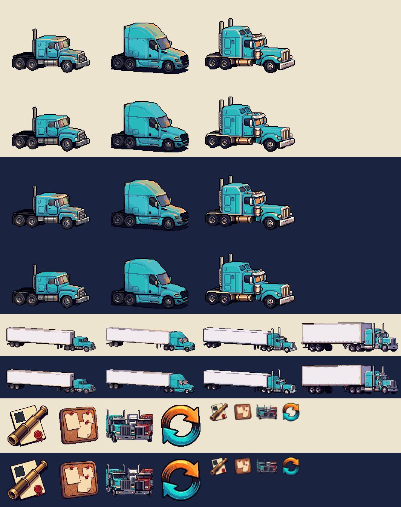

# Sprint 3 prep: one-paint make cards, rig cards per make, four icons (art, 2026-11-03)

The sheet, top to bottom:
- **Make cards** on the light theme, then the dark: the cards as they were, then as they are now.
- **Rig cards** on both themes: Keystone, Meridian and Ironwood, beside today's van card.
- **Icons** on both themes: intel, book, carriers and switch at full size, then at 28 px.

## 1. The make cards, one paint each

The repaint had put a warm late-light glow on the roofs, strongest on the Meridian's. On a light card it read as a
second paint colour.

**The fix:**
- `makes.py fit` now asks the model which pixels are cab paint. Every lit pixel there, and any warm one at its edge,
  goes onto the cab cyan by brightness.
- Each cab is now one paint colour, shaded, on both themes.
- Outlines, seams, glass, chrome and the amber lamps are untouched. The Ironwood's chrome and the Keystone's grey
  stack keep their colour.

**Files:** `apps/web/assets/makes/{keystone,meridian,ironwood}.png`, the same size and place as before.

## 2. A rig card per make

**Files:** `apps/web/assets/makes/{keystone,meridian,ironwood}-rig.png`.
- **Frame:** 256 × 96, the rig cards' own frame.
- **Trailer:** each make pulls a plain white 53-foot dry van.
- **Camera and scale:** the make cards' three-quarter camera and ground row, all three at one scale (3.5 px a foot),
  so the Ironwood rig is the longest and the Meridian's roof sits flush with the trailer.
- **Paint:** the trailer is fitted onto today's van card's whites, the same way the cabs are fitted to its cyan, so it
  stays white on both themes.

**How they're made:**
- **Keystone and Ironwood:** their layouts were repainted whole.
- **Meridian:** four whole-rig repaints each came back redrawn at another scale. So its tractor was repainted alone,
  in its place, and the trailer is the Keystone rig's painted trailer moved to the Meridian's fifth wheel.
  - Where the Keystone's tractor hid part of the box, the Ironwood's trailer fills in.
  - The trailer is lined up by its tail, the end no tractor hides.
- **Recipe:** the `makes` recipe in `asset-pass.sh`, plus `makes.py rigs`, `rig-tractor` and `rig-compose`.

## 3. Four icons

These match `apps/web/assets/icons`: painted 128 × 128 on transparency in the title's style, made by `tools/icons.sh`,
with no lettering.

| File | Where | Picture | At 28 px |
|---|---|---|---|
| `intel.png` | the More list | a brass spyglass across a company dossier with a blank photo and a red wax seal | reads |
| `book.png` | the brokerage's bar | a cork board, three blank sheets pinned at angles with red pins | reads |
| `carriers.png` | the brokerage's bar | two rigs side by side, a cyan cab and a red one, a white one behind | reads as trucks; it is the busiest of the four |
| `switch.png` | the company switcher in the top strip | two thick arrows, orange and cyan, chasing round a circle | reads down to 16 px on both themes |

- **Redraws:** the first `book` (a square board of four sheets) read as a window at 28 px. The first `carriers`
  (three small trucks) didn't fill its frame. Both were redrawn.
- **The top strip's switch:** `icons/switch16.png` is a hand-drawn version for the top strip, 16 × 16 and crisp. It has
  the same two arrows (amber over cyan, ink outline) in palette colours. Show it at whole-number scales only (1×, 2×)
  and unsmoothed; the painted one blurs below about 16 px. It's made by `tools/switch-glyph.py`.

## Cost

About 130 generations:
- 70 on the rig cards, 50 of them on the Meridian;
- 60 on the icons.
