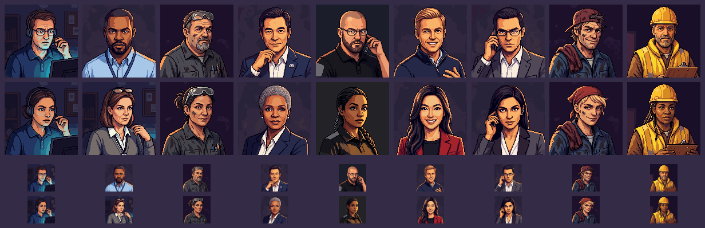
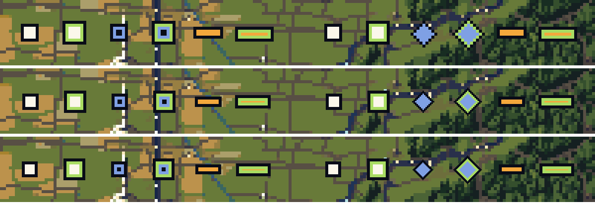

# Staff portraits for both looks, and the reefer's map mark (art, 2026-11-03)

These two fixes come from QA's replay, via the producer.

1. **Portraits.** Each non-driver kind had one portrait, so half the staff names couldn't match their faces. The five
   manager and executive kinds had no portrait of their own at all; they all borrowed the dispatcher's headset.
2. **Reefer mark.** At the opening zoom the reefer's mark read poorly next to the van's.

## Portraits

Columns, left to right: dispatcher, operations manager, maintenance manager, CEO, security manager, sales rep,
broker, mechanic, dock worker. Men on top, women below, then the same faces at the roster's 48 px.

Each kind keeps what says its job, so a manager never reads as a dispatcher:

| Kind | What says the job |
|---|---|
| Dispatcher | headset, polo, a monitor's glow |
| Operations manager | lanyard with a blank card, office shirt, no headset |
| Maintenance manager | safety glasses pushed up, shop shirt with pens |
| CEO | navy suit |
| Security manager | black polo, radio earpiece |
| Sales rep | quarter-zip or blazer, a salesman's smile |
| Broker | suit, phone or earpiece |
| Mechanic | coveralls, rag, cap or bandana |
| Dock worker | hard hat, hi-vis vest, clipboard |

**Files** (`apps/web/assets/people/`):
- **Naming:** each portrait is `<kind>-m.png` and `<kind>-f.png`, with its `.loop.png` and `.loop.json`.
- **Kinds:** `dispatcher`, `ops-manager`, `maint-manager`, `ceo`, `security-manager`, `sales-rep`, `broker`, `mechanic`
  and `dockworker`. The engine's kinds are camel case (`opsManager`, `maintManager`, `securityManager`, `salesRep`).
- **Originals:** the four original portraits were all men. `<kind>-m` is a copy of each, so every kind can be picked
  as `<kind>-<look>`. The originals stay where they are until `assets.ts` moves.

**How they're made:**
- **Style:** each is a PixelLab Pro picture, 128 × 128, drawn with an original portrait as its style image, so the
  lighting matches its kind. The office kinds use the dispatcher's or the broker's light; the maintenance manager
  uses the mechanic's.
- **One redraw:** the first male operations manager picked up the dispatcher's headset and monitor, so he was
  redrawn in the broker's light.
- **Loops:** the drivers' idle loop. Portraits with a hand up at the ear or chin get a variant that moves only the
  face, with the head and hands held still. A moving hand is where Iuliia's third arm came from.
- **Loop checks:**
  - Every loop was checked for colour drift and for the jump at the wrap.
  - Three loops were redrawn for jumping at the wrap.
  - dockworker-f came out orange twice. The second try was fitted back to her still, and her wrap is now no bigger
    than her ordinary frame steps.
  - On the frame strips, no hand moves and no arm appears.
- **Old dockworker loop:** the original dockworker's loop (October 29), which the Loads panel shows today, turned
  orange through its second half and popped back to yellow at the wrap. Its loop is redrawn, and the still is
  unchanged.
- **Cost:** about 190 generations.
- **Recipe:** `staff` and `staffloops` in `apps/web/tools/asset-pass.sh`.

## The reefer's mark on the map

- **The marks:** at the opening zoom, other carriers' trucks are marks rather than sprites. The van is a solid white
  square and the flatbed a low amber bar. The reefer was the van's square, hollowed out.
- **The problem:** at 3–4 px the hollow square is a thin blue ring around a dark centre, which reads as a dark dot.
- **The fix:** the reefer is now a **blue diamond**, outlined in ink like the others and ringed in lime for a player.
  Square, diamond and bar are three shapes that still differ at that size, as the director's gate asks: shape as well
  as colour.
- **Code:** `apps/web/src/mapview.ts`, the other carriers' marks only. The diamond is drawn once per size into a small
  canvas and reused, so a busy interstate costs one image draw per reefer.
- **Checked:** in a local test world at the opening zoom.
